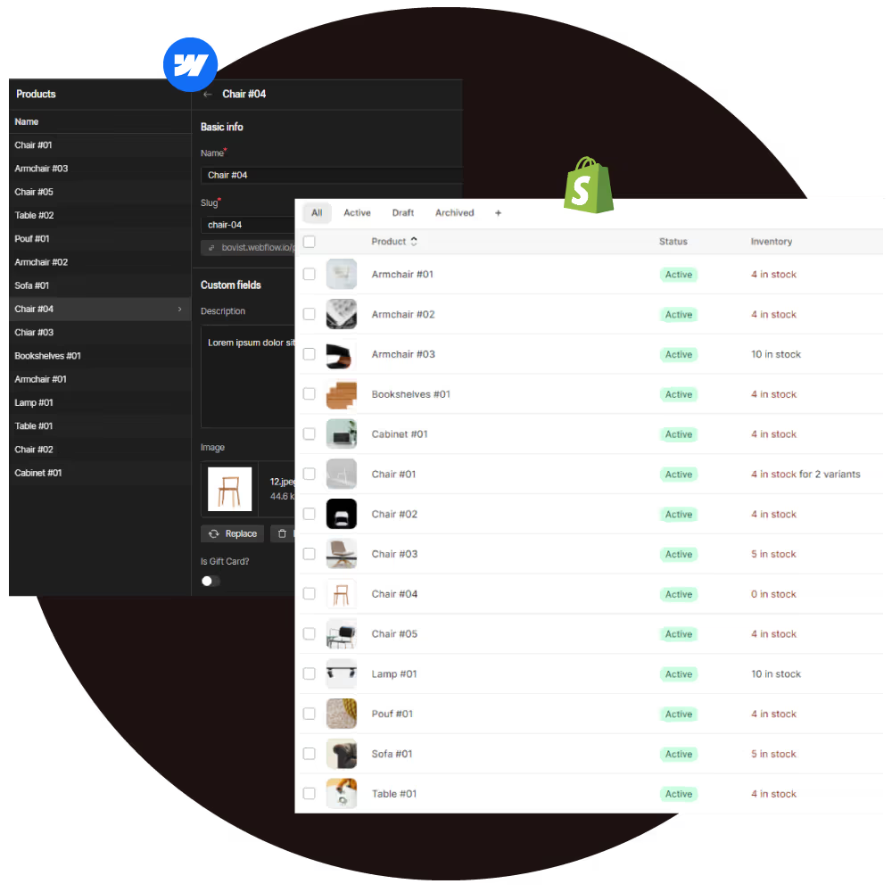

# 🛒 Smootify — Webflow & Shopify Connected

<div align="center">



**Design complex Shopify stores completely within Webflow, assisted by AI.**

[](https://smootify.netlify.app/)
[](https://github.com/YASAR300/smootify)

</div>

---

## ✨ Overview

**Smootify** is a high-performance integration platform that redefines e-commerce development. It allows you to design your shop in Webflow, connect it via Smootify, and manage everything with Shopify. This repository contains the high-fidelity UI clone demonstrating the platform's sophisticated interaction design and branding.

> Built from scratch with raw **HTML**, **CSS**, and **GSAP** to showcase advanced animation choreography, custom scroll logic, and premium UI/UX design.

---

## 🚀 Live Preview

🌐 **[https://smootify.netlify.app/](https://smootify.netlify.app/)**

---

## 🛠️ Tech Stack

| Technology | Purpose |
|------------|---------|
| **HTML5** | Semantic structure |
| **CSS3** | Premium dark-mode design system |
| **GSAP** | High-end interaction & motion design |
| **Locomotive Scroll** | Smooth inertia-based scrolling |

---

## 🎨 Key Features

- 🌑 **Premium Dark Aesthetic** — Sophisticated e-commerce dashboard and landing page design.
- ⚡ **Seamless Integration Narratives** — Visualizing the connection between Webflow, Shopify, and AI.
- 🖱️ **Custom Interactions** — Fluid hover states, magnetic buttons, and custom cursor mechanics.
- 📱 **Fully Responsive** — Adaptive layouts that maintain design integrity across all viewports.
- 🎭 **Kinetic Typography** — GSAP-driven text animations and reveals.

---

## 📁 Project Structure

```
smootify/
├── index.html          # Main HTML structure
├── style.css           # Complete design system & animations
├── script.js           # GSAP animations & interaction logic
├── img/                # Assets — images, SVGs, video files
│   ├── assets/         # Icon sets and UI assets
│   └── ...             # Project media files
└── README.md           # You are here
```

---

## 🏃 Getting Started

### Prerequisites
- Any modern browser (Chrome 90+, Firefox 88+, Safari 14+, Edge 90+)
- A local development server (Live Server, Vite, or similar)

### Running Locally

```bash
# Clone the repository
git clone https://github.com/YASAR300/smootify.git

# Navigate into the project
cd smootify

# Open with Live Server (VS Code extension)
# Or serve with Python
python -m http.server 3000

# Then open http://localhost:3000
```

> ⚠️ **Note:** Open via a local server, not by double-clicking `index.html` directly — some assets require an HTTP context.

---

## 🖼️ Screenshots

| Hero Section | Features |
|:---:|:---:|
|  | E-commerce Interface |

---

## 💡 What I Learned

- **GSAP ScrollTrigger** — Advanced pinning, scrubbing, and timeline synchronization with scroll position
- **Custom Scroll Engines** — Integrating Locomotive Scroll as a virtual scroll driver for GSAP
- **Animation Architecture** — Building modular, reusable animation functions that scale across a codebase
- **CSS Custom Properties** — Designing a comprehensive token-based design system without a framework
- **Performance Optimization** — `will-change`, GPU compositing layers, and avoiding layout thrashing

---

## 🌐 Deployment

The project is deployed on **Netlify** with automatic CI/CD from the main branch.

[](https://smootify.netlify.app/)

---

## 👤 Author

**Yasar Khan**
- GitHub: [@YASAR300](https://github.com/YASAR300)
- Portfolio: [yasarkhan.dev](https://your-portfolio-link.com)

---

## 📄 License

This project is licensed under the **MIT License** — feel free to use it as inspiration, but please give credit if you do!

---

<div align="center">

**⭐ If you liked this project, please give it a star!**

Made with ❤️ and a lot of GSAP magic by **Yasar Khan**

</div>
